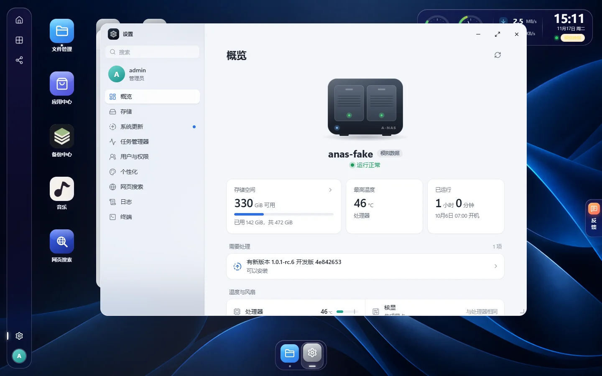

# A-NAS

基于 Debian 的家庭 AI NAS：在网页桌面里管理文件、相册与影音。项目首先保证存储、权限、备份与恢复可靠；AI 在设备上运行，是可关闭、可审计、可替换的上层能力。

[](https://github.com/zhongwater123/A-NAS/actions/workflows/ci.yml)

> [!WARNING]
> 实验阶段：实验 NAS 跟随主干部署，只放可丢弃的测试数据，不是家庭生产版。当前基线是 [v1.0.1 基础存储与共享闭环](docs/releases/v1.0.1.md)，实机验收完成前只发布 `v1.0.1-rc.N`。已部署什么、还差哪些验收，见[当前状态](docs/status/CURRENT.md)。



局域网里的电脑和手机用浏览器访问 NAS；在外面经设备的域名以 HTTPS 访问；NAS 直连的屏幕运行同一个桌面。

## 功能

每项链接到它的规格，规格写行为与边界；实现阶段见[规格索引](docs/specs/README.md)。

**存储与文件**

- [文件与共享](docs/specs/basic-storage-and-sharing.md)：每位成员一个个人空间，全家共用一个 Shared；网页与 Windows SMB 都以登录者本人的 Linux 身份读写，由内核 ACL 授权，删除先进回收站。
- [硬盘与数据卷](docs/specs/disk-roles-and-redundancy.md)：新硬盘在设置中加入数据卷，选镜像、扩容或条带；镜像少一块盘时继续服务。
- [备份中心](docs/specs/backup-center.md)：定时快照、智能保留、历史版本与整体恢复；备份到外接盘仍在规划。
- [传输中心](docs/specs/transfer-center.md)与[成员分享](docs/specs/member-sharing.md)：可续传上传、打包下载，成员之间分享固定副本。

**相册与影音**

- [相册](docs/specs/photo-library.md)：时间线、动态照片与视频；搜索、AI 聚合、人物宠物识别和照片中的文字，都由设备上离线运行的本地模型完成。
- [影视中心](docs/specs/media-center.md)与[音乐](docs/specs/music.md)：原地索引影片与音频，浏览器不能直接播放的格式在设备上转换。
- [照片打分](docs/specs/photo-scoring.md)：可移除模块，选定的成员给照片打美学分，打分结束后整体移除。

**家庭与 AI**

- [家庭中心](docs/specs/family-center.md)：家人在宝宝频道里一起记录照片视频、录音、身高体重、疫苗与大事记。
- [AI 助手 VNAS](docs/specs/ai-assistant.md)：每位成员一个沙箱中的 Hermes Agent，只读本人能读的位置，写入前由本人确认；随主软件包安装，管理员在“设置 → VNAS”中填写 DeepSeek 密钥后全家可用，用云端模型。
- [虚拟伙伴](docs/specs/virtual-companion.md)：桌面上的“大肥鱼”，随 VNAS 的对话切换动作。
- [网页搜索](docs/specs/web-search.md)：内置 SearXNG，在桌面上直接搜索互联网，管理员可以关闭。

**系统**

- [应用中心](docs/specs/app-center.md)与[容器管理](docs/specs/container-management.md)：安装第三方应用，管理 Docker 容器。
- [设置](docs/specs/settings.md)：账号与权限、存储、个性化、系统健康、设备温度、任务管理器、日志，以及管理员可选开启的终端。
- [系统更新](docs/specs/system-update.md)：在设置中下载并安装新版本，安装后检查不通过时自动回到原来的版本。
- [局域网访问](docs/specs/lan-web-access.md)、[互联网访问](docs/specs/internet-access.md)，以及直连屏幕的[开机动画](docs/specs/boot-ident.md)与[屏保](docs/specs/local-console-screensaver.md)。

## 快速开始

第一次体验网页桌面，只需自己的开发机。下面两条命令在 Linux 终端或 Windows 的 WSL2 终端运行，使用模拟数据，不碰真实磁盘。macOS 请用 [Colima 预览步骤](docs/development/environments/macos.md#fake-预览)。如果要跑检查、复测模型或验收设备，先[按任务选运行环境](CONTRIBUTING.md#按任务选运行环境)。

在检出根目录执行，需要 Go（版本见 `.go-version`）、Node（见 `.nvmrc`）与 gcc：

```bash
make web-build
ANAS_HOSTSTATE_MODE=fake go run ./cmd/anas-api
```

然后在浏览器中打开 `http://127.0.0.1:8080/`，按页面提示创建管理员。`ANAS_HOSTSTATE_MODE` 没有默认值，不设置时服务拒绝启动。其他变量、终端与 Docker 的本地模式见 [CONTRIBUTING.md](CONTRIBUTING.md#在本地运行)。

## 部署到设备

A-NAS 以签名软件源中的 Debian 软件包发布（[ADR 0034](docs/adr/0034-release-as-signed-debian-packages-and-update-devices-with-sysupdate.md)）。开发机跑完门禁与系统测试后，用 `make release` 把软件包放进软件源；软件源复制到 NAS 后，设备所有者以 root 用 apt 安装、升级与回滚，用 `a-nas-check` 检查。步骤见[部署 A-NAS 软件包](docs/runbooks/deploy-a-nas-packages.md)，破坏性的磁盘操作见[实机配置手册](docs/runbooks/provision-v1.0.1-experimental-storage.md)，其余见[运行手册索引](docs/runbooks/README.md)。

## 架构

产品服务与 Host Agent 用 Go，网页桌面用 React、TypeScript 与 Vite，相册的本地 AI Worker 用 Python；控制面数据库是 SQLite/WAL，数据卷是 Btrfs（[ADR 0007](docs/adr/0007-use-btrfs-sqlite-and-a-typed-privilege-boundary.md)）。各组件以不同的系统身份运行，特权只在 Host Agent 中；数据流与不变量见[架构总览](docs/architecture/OVERVIEW.md)。

| systemd 单元 | 身份 | 职责 |
|---|---|---|
| `anas-api` | `a-nas` | 产品服务：网页桌面与 REST API，只监听回环地址 |
| `anas-host-agent` | root | 类型化的特权操作（身份、ACL、卷、Samba、快照）与文件代理；不提供任意 Shell |
| `anas-photos` | `a-nas-photos` | 相册服务，独占数据卷上的照片库（[ADR 0011](docs/adr/0011-run-the-photo-library-as-a-dedicated-service-identity.md)） |
| `anas-shares` | `a-nas-shares` | 成员分享的独立副本（[ADR 0023](docs/adr/0023-isolate-member-share-copies-in-a-dedicated-service.md)） |
| `anas-family` | `a-nas-family` | 家庭中心（[ADR 0029](docs/adr/0029-keep-the-baby-as-a-profile-and-channel-photos-in-the-shared-library.md)） |
| `anas-ai` | `a-nas-ai` | 相册的本地 AI Worker，经套接字按需启动，无网络、看不到数据卷（[ADR 0016](docs/adr/0016-ship-photo-ai-as-a-built-in-offline-capability.md)） |
| `anas-ffmpeg@` | 动态身份 | FFmpeg Worker（FFmpeg 与 libheif），按连接启动，无网络、看不到数据卷 |
| `anas-vectors@` | `a-nas-vec-<所有者>` | 向量索引：每个所有者一个可重建的 Qdrant 实例，无网络（[ADR 0028](docs/adr/0028-index-vectors-in-a-rebuildable-qdrant-instance-per-owner.md)） |
| `anas-search` | `a-nas-search` | 网页搜索（SearXNG），看不到数据卷（[ADR 0030](docs/adr/0030-ship-web-search-as-a-built-in-searxng-service.md)） |
| `anas-update` | root | 系统更新，由定时器触发检查、下载与安装 |
| `anas-container-agent` | `anas-container` | Docker 的类型化代理（[ADR 0009](docs/adr/0009-use-docker-engine-through-a-dedicated-container-agent.md)） |
| `caddy`、`smbd` | — | 局域网 Web 入口（[ADR 0012](docs/adr/0012-serve-the-web-desktop-on-the-lan-over-http-through-caddy.md)）、启用时的互联网入口（[ADR 0032](docs/adr/0032-reach-the-web-desktop-from-the-internet-through-an-edge-relay.md)）与 SMB3 |
| `anas-kiosk@tty1` | `a-nas-kiosk` | 直连屏幕上的 Cage + Chromium |

照片打分模块的 `anas-module-scoring` 不在主软件包里，随它的安装脚本安装。

## 参与开发

- 开发者：从[按任务选运行环境](CONTRIBUTING.md#按任务选运行环境)开始；提交改动见[提交与 PR](CONTRIBUTING.md#提交与-pr)。
- AI Agent：从 [AGENTS.md](AGENTS.md) 开始，它是唯一的项目指令文件，Claude Code 直接读取。

## 文档导航

| 我想了解 | 看这里 |
|---|---|
| 现在部署了什么、下一步、等谁决定 | [当前状态](docs/status/CURRENT.md) |
| 某个功能应该怎样表现 | [规格索引](docs/specs/README.md) |
| 组件边界、数据流与不变量 | [架构总览](docs/architecture/OVERVIEW.md) |
| 难以逆转的技术决定及其原因 | [ADR](docs/adr/README.md) |
| 用户作出的产品决定 | [决定记录](docs/decisions/README.md) |
| 安装、部署、恢复与磁盘操作 | [运行手册](docs/runbooks/README.md) |
| 各版本的变化 | [CHANGELOG](CHANGELOG.md)、[发布记录](docs/releases/README.md) |
| 产品与领域用语 | [CONTEXT.md](CONTEXT.md) |
| 早期产品背景与研究 | [PROJECT_CONTEXT.md](PROJECT_CONTEXT.md)（不代表当前状态） |

文档的分类与维护规则见[文档系统](docs/README.md)。

## 版权

© 2026 A-NAS 作者。保留所有权利。本仓库公开供查看，没有附开源许可证：未经著作权人书面许可，不得复制、修改、分发本仓库的代码与文档，也不得用于任何商业用途（[决定记录](docs/decisions/2026-11-17-all-rights-reserved.md)）。

自带许可证的第三方代码仍按其许可证使用，例如 [CasaOS 应用目录](internal/appstore/catalog/NOTICE.md)（Apache-2.0）、[Hermes 界面代码](web/src/assistant/hermes/LICENSE)与 [dsh-pet](web/src/companion/dsh-pet/LICENSE)（MIT）。
