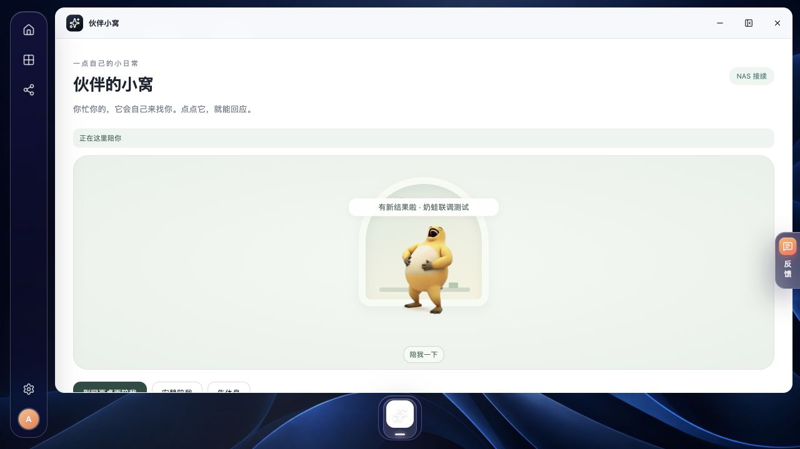
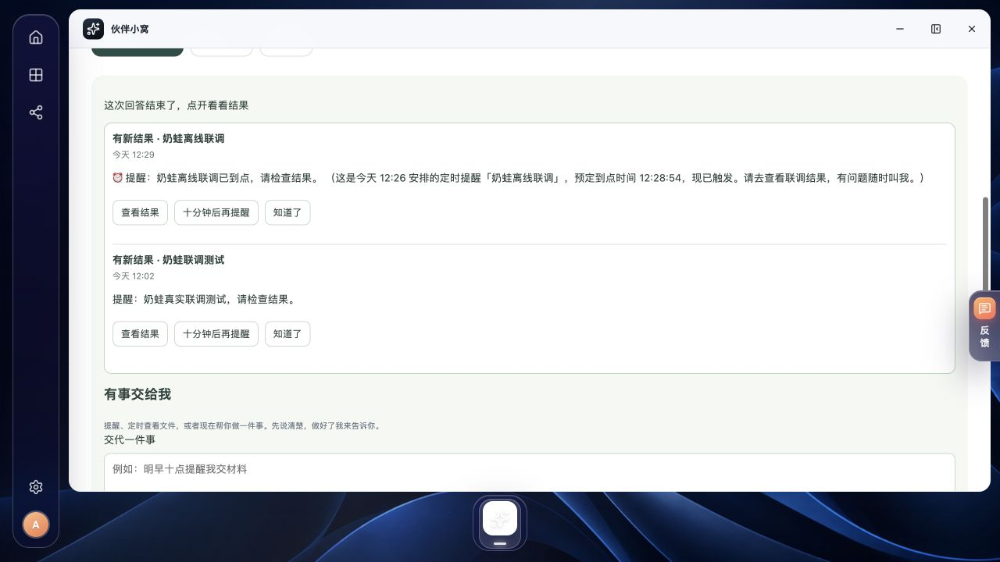
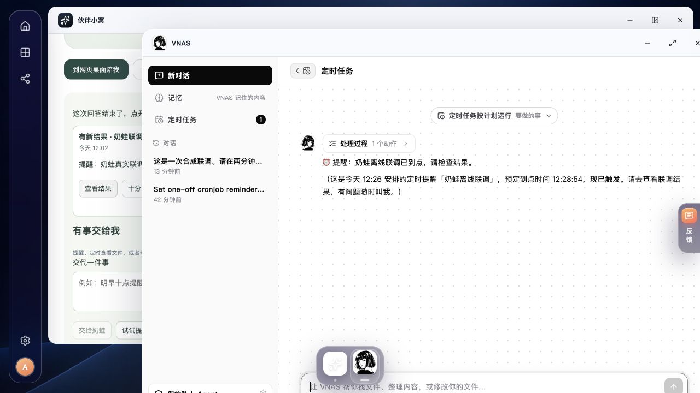

# 奶蛙提醒的真实运行时联调

检查日期：2026-11-03

## 结论与环境

已在当前 Mac 的独立 Debian 13 ARM64 虚拟机中验证：奶蛙网页交代 → Qwen 理解 → Hermes `cronjob` 保存一次性任务 → systemd 唤醒 → 真实模型生成提醒 → VNAS 未读通知 → 奶蛙结果卡 → 原运行记录与已读回执。

这是本机开发联调，产品服务使用 Fake 宿主机 Adapter。Hermes、模型网关、成员沙箱、cron tick、唤醒脚本、账号数据库、通知和网页组件为真实实现；身份查询辅助进程复用生产的只读 `sessiondir` / `sessionlookup`，未启动完整 Host Agent 的磁盘管理。它不代表公司 NAS、真实 Btrfs/SMB、文件保存确认或 Electron 已登录接续验收。

| 项目 | 本轮配置 |
| --- | --- |
| Hermes | 仓库固定提交 `0e427d788d253630d38a3a51cd76849e73cd6925`，加仓库三个补丁 |
| 运行时 | CPython 3.14.8，Hermes 安装的 OpenAI SDK 2.24.0；按上游锁文件导出并校验依赖哈希 |
| 构建工具 | uv 0.13.7；原 0.12.3 没有该 Python 下载条目，未因此降低 Python 版本 |
| 模型 | `qwen3.8-flash`，经项目 Unix socket 网关和显式 HTTP CONNECT 代理 |
| 凭据 | 仍由 Mac 上的网关加载；未放进助手沙箱、源码、截图或联调归档 |
| 限额 | 网关最多放行 12 次模型请求，实际 11 次；单轮最多 5 次迭代 |
| 时区 | 测试虚拟机为 Asia/Shanghai；任务列表明确显示日期和 GMT+8 |

固定运行时构建依据见[构建脚本](../../ai/assistant-spike/build-runtime.sh)与[补丁](../../ai/assistant-spike/hermes-patches/)，原模型协议检查见[Qwen 接入检查](qwen-companion-capability-check.md)。

## 两条真实任务

| 检查 | 网页交代 | 无人在线执行 |
| --- | --- | --- |
| 名称 | 奶蛙联调测试 | 奶蛙离线联调 |
| 任务 ID | `2e09609eb230` | `d7e27c868663` |
| 交代方式 | 实际登录页面的“交给奶蛙” | 退出网页账号后，既有 `serve_client.Gateway` 直接访问同一真实实例协议 |
| 计划到点 | 2026-11-03 12:01:36 +08:00 | 2026-11-03 12:28:54 +08:00 |
| 上次运行记录 | 12:02:20 +08:00，`ok` | 12:29:48 +08:00，`ok` |
| 最终记录 | 一次性、completed、completed 次数 1、enabled=false、无下次运行 | 同左；会话实例停止后任务仍存在，等待与运行期间轮询观察会话实例为 inactive |

上次运行记录不是秒级送达承诺；这条链路包含唤醒轮询、模型处理和一分钟级通知读取。本轮两条任务的记录时间分别比计划晚约 44 秒和 55 秒，没有压低生产轮询间隔来伪装秒级提醒。

离线用例中产品预览进程也暂时停止，真实唤醒服务仍按成员身份检查账号，再启动独立的 `anas-assistant-cron@agentdemo.service`。运行完恢复产品服务，重新登录后实际出现离线结果卡。点“查看结果”进入原 VNAS 定时运行对话，显示“定时任务按计划运行”，不是另开一个推测任务已完成的对话。

## 状态、隔离与失败记录

- 沙箱以测试成员 UID 20100 运行；合成个人文件可读且不可写，助手目录可写；Mac `/Users` 挂载与实例凭据不可读，外网 TCP 不可达。这里只用合成 canary 检查可见性，没有读取私密文件内容。
- “查看结果”清除了离线结果的未读；另一条结果的“知道了”也被服务端接受。最终两条通知均已读，两个任务的运行次数仍各为 1，没有将用户事项标记完成，没有留周期任务。
- 实测发现通知结束后会重新庆祝旧对话，现恢复为已平静的旧状态；连接恢复加载历史结果同样不重播情绪。回归覆盖旧成功与旧失败两种情况。
- 首次独立身份预检漏传本机查询 socket，误查 NAS 默认路径并报 `FileNotFoundError`；真实唤醒服务配置正确、任务照常成功。原始失败报告保留，按服务实际环境补查返回成功，未重新请求模型或修改已有任务记录。

可复核记录保存在本机被 Git 忽略的 `build/companion-review-20261102/`：`offline-reminder-raw.json`（原始预检失败）、`offline-reminder-validation.json`（明确记录纠正）、`final-state-validation.json`、`local-model-usage.jsonl` 与 Web 检查日志。模型日志只记消息数量和用量。当前 Mac 的运行时构建、配置和单次提醒测试脚本另保存在 `~/Projects/.anas-pr346-runtime/`；这些机器专用脚本不能直接拿到真实 NAS 上执行。

## 主线同步与本地 Linux 门禁

本地合并 main `41464cad`，解决六处冲突并由 `make api` 重新生成接口文件。主线的网页搜索、相册 OCR 分流与助手停用修复均保留；没有新建 PR。完整门禁验证提交为 `0b3f03107d58`。

| 检查 | 结果 |
| --- | --- |
| `ANAS_QDRANT_REQUIRED=1 make check` | 通过，生成 `build/.validated-build`；包含真实 Qdrant 向量测试、完整 Go 测试、格式与静态检查、实时漏洞扫描和三个 Linux 二进制构建 |
| `make race-test RACE_PARALLEL=1` | 通过，仍设置 `ANAS_QDRANT_REQUIRED=1`；原内存条件下已通过的包由 Go 测试缓存复用，相册服务在增加内存后实跑通过 |
| Web | 87 个文件 / 643 项测试全部通过，typecheck、lint、生产构建及体积检查通过 |
| Python | 72 项，15 项按原规则等待真实模型条件而跳过；Ruff 通过 |
| 原生桌宠 | 通信策略 3 项通过，桌宠 renderer 重新构建通过 |
| 页面回归 | 更新同一套独立 Fake 预览，登录仍有效；两条旧提醒均已完成、不再运行、运行记录各 1 条；查看结果打开原 VNAS 运行；捉迷藏和收花实际点通；没有新增模型请求 |

检查在当前 Mac 的独立 Debian 13 ARM64 VM 原生 ext4 检出执行，Go 1.27.3、Node 26.9.0、ShellCheck 0.11.0、lychee 0.24.2、Ruff 0.17.1。Qdrant 使用官方同版本 ARM64 musl 发布包，归档 SHA-256 为 `bd8a458b8ef8006ce2c603c5bd6d1d973e39d787f794008dd959112e747c3bb7`，核对后验证 `qdrant 1.20.0` 可运行，并以 `ANAS_QDRANT_BINARY` 指定。没有改 x86_64 生产清单或关闭强制测试。

环境初始缺 `make`、`jq`；2 GiB VM 上 Oxlint 的大块虚拟内存分配崩溃，Go 检查工具随后被内核 OOM 终止。补齐工具、增加 3 GiB 临时交换空间，并仅在门禁进程存续期间将此开发 VM 的 `vm.overcommit_memory` 从 0 调整到 1，退出已恢复 0；未修改产品单元、成员沙箱或检查规则。Oxlint 的同类限制见[上游记录](https://github.com/oxc-project/oxc/issues/20331)。完整检查还暴露两个依赖文件时间戳变化的测试准备问题；复现、修复及元数据缓存的能力边界见[原调查](../investigations/2026-10-14-file-preview-cache.md#linux-开发机的时间戳测试准备)。

首次竞态检查中，相册服务两项后台 AI 用例因实际可用内存只有约 614–865 MiB、低于 1 GiB 保留量而超时；未报告数据竞争。将开发 VM 的物理内存从 2 GiB 增到 3 GiB，重启并恢复两套 Fake 预览、只读账号查询、审批代理、唤醒服务和模型通道后，重跑原竞态入口通过，相册服务实跑 1.919 秒；另以 `go test -race ./internal/photoservice -count=3` 连续三次通过。没有降低保留量、注入虚假资源读数或跳过失败用例。检查结束已清理临时交换文件，VM 保持 3 GiB 继续试玩。重启后网页登录和旧任务仍可读，模型目录返回 HTTP 200；没有追加推理调用。这不等同于真实 NAS 的安装或重启验收。

本机 `build/companion-review-20261102/` 保存完整检查日志、校验清单、工具版本与归档哈希。最初的工具崩溃、OOM、测试失败及修复前后重复验证记录均保留，未用单独通过项替代完整门禁结果。

## 后续验收边界

真实 NAS 继续按[内网验收手册](../runbooks/accept-virtual-companion.md#提醒与主动回报的运行时验收)检查重启、成员隔离、文件确认、跨设备已读和 Electron 登录；触屏维持硬件待办。本轮没有完成这些验收。

换成本地模型沿用同一传输接口，仍需单独验证上下文、工具选择和执行可靠性。本轮 Hermes 首次请求约 1.9 万 prompt tokens，不能由云端成功推断 4B 模型及现有显存配置可以直接承接完整工具集。

本轮结束后关闭计数测试网关，另保留本机的手动试玩通道与已完成记录；没有再发送自动模型测试请求。两条测试任务均已结束、无下次运行，后续调用由成员主动交代产生。手动试玩通道继续使用私密文件加载凭据，Unix socket 的宿主目录仅本人可进入；未注册 Mac 登录自启。这不是常驻助手部署，运行依赖当前 Mac、虚拟机与临时 SSH 转发。公司 NAS 上的模型网关和唤醒服务应独立配置。

## 关联

- [任务入口](../../web/src/companion/TaskExperience.tsx)、[结果卡](../../web/src/companion/TaskInbox.tsx)与[情绪回归](../../web/src/companion/companion.test.tsx)
- [实例单元](../../ai/assistant-spike/anas-assistant@.service)、[定时唤醒](../../ai/assistant-spike/cron-waker.py)与[通知记录](../../internal/assistantapi/tasknotices.go)
- [云端与本地网关配置](../runbooks/try-ai-assistant-on-experimental-nas.md#qwen-云端联调与后续本地接入)
